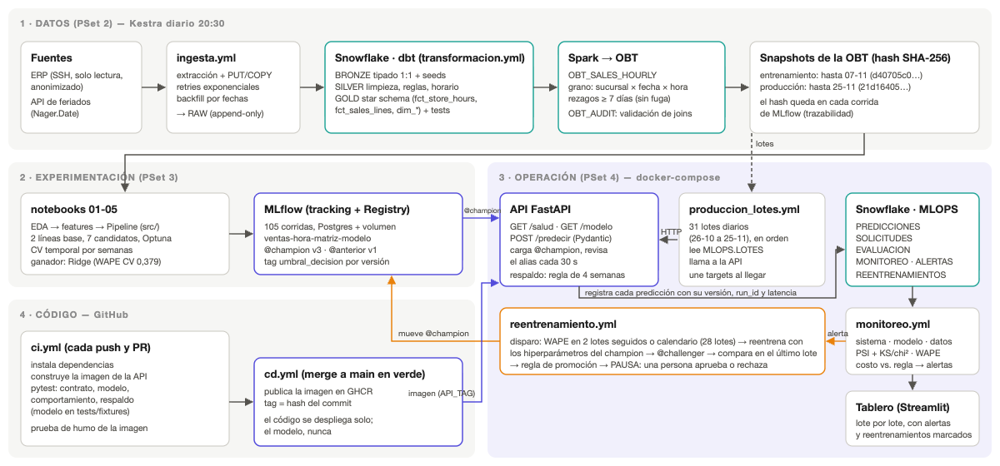

# Proyecto final · Pronóstico de ventas por hora y refuerzo de personal

Ciencia de Datos (USFQ). Pronóstico de las ventas por hora de la matriz de una tienda para decidir, cada semana, en qué horas programar un vendedor de refuerzo: una hora necesita refuerzo si se esperan 8 o más ventas por vendedor presente.

```
Fuente (ERP + feriados) → Kestra → Snowflake RAW → dbt (Bronze → Silver → Gold) → Spark (OBT)
  → EDA y modelo (MLflow) → Model Registry (@champion) → API FastAPI (Docker, GHCR)
  → simulación de producción (Kestra) → PREDICCIONES → monitoreo y alertas → reentrenamiento con aprobación
```



| Entregable | Dónde |
|---|---|
| Documento técnico | `docs/PSet4_memo_Torres_Chicaiza.pdf` |
| Presentación ejecutiva | `docs/PSet4_presentacion_Torres_Chicaiza.pdf` |
| Correcciones y decisiones actualizadas | `docs/cambios.md` |
| Evidencia | `docs/corridas.csv`, `docs/reentrenamientos.csv`, `docs/predicciones.csv`, `docs/monitoreo.csv`, `docs/alertas.csv` (más `docs/evaluacion.csv` y `docs/decisiones.csv`) |
| Memos anteriores | `docs/historial/` |

## Estructura

| Ruta | Contenido |
|---|---|
| `docker-compose.yml`, `Makefile` | Toda la infraestructura (Kestra, Spark, MLflow, API, tablero) y los atajos |
| `kestra/` | `ingesta.yml` y `transformacion.yml` (PSet 2); `produccion_lotes.yml`, `monitoreo.yml` y `reentrenamiento.yml` (PSet 4); imagen `runner/` y scripts de extracción |
| `dbt/`, `spark/` | Bronze, Silver y Gold con sus pruebas; construcción de la OBT |
| `src/` | `datos.py` y `pipeline.py` (PSet 3), `reentrenar.py`, `simulacion.py`, `mlops.py`, `produccion.py`, `exportar.py` |
| `notebooks/` | 01-05 (PSet 3), `06_simulacion_produccion`, `07_analisis_monitoreo` |
| `api/` | `main.py` (endpoints), `esquemas.py` (contrato Pydantic), `servicio.py` (carga por alias, recarga y respaldo), `registro.py`, `Dockerfile` |
| `monitoreo/` | `deriva.py` (PSI, KS, chi²), `alertas.py` (catálogo), `ejecutar.py` |
| `tablero/` | Tablero de Streamlit |
| `tests/` | `test_contrato.py`, `test_modelo.py`, `test_comportamiento.py`, `test_respaldo.py`; `fixtures/` con la copia del modelo |
| `.github/workflows/` | `ci.yml` (pruebas en cada push y PR) y `cd.yml` (imagen a GHCR en cada merge a `main`) |

## 1. Requisitos y credenciales

- Docker (probado con OrbStack) y Python 3.12 (`uv` o `venv`).
- Una cuenta de Snowflake. Ejecuta `docs/datos/snowflake_setup.sql` en Snowsight como ACCOUNTADMIN: crea el warehouse, la base `PSET2`, sus esquemas (incluido `MLOPS`), el rol y el usuario de servicio con autenticación por par de llaves.
- Acceso de solo lectura a la fuente: una llave SSH dedicada con *forced command* en el servidor del ERP (`kestra/server/pset2_extract.sh`; ver `docs/historial/PSet2_memo_Torres_Chicaiza.pdf`, anexo A).

```bash
cp .env.example .env                       # completa los valores (ver comentarios)
cp <llave-snowflake>.p8 secrets/snowflake_rsa_key.p8
cp <llave-ssh>          secrets/kestra_ssh_ed25519
uv venv --python 3.12 .venv && uv pip install --python .venv/bin/python -r requirements.txt
make secrets                               # genera .env.kestra y .env.runtime (no se versionan)
```

`.env`, `.env.kestra`, `.env.runtime` y `secrets/` están en `.gitignore`: el repositorio no contiene credenciales.

## 2. Levantar la infraestructura

```bash
make build    # imágenes locales: runner (ingesta + dbt), Spark, ML (tareas + tablero) y MLflow
make up       # Kestra, Spark, MLflow, API y tablero con un solo comando
make deploy   # publica los flujos de kestra/*.yml
```

| Servicio | URL |
|---|---|
| Kestra | <http://localhost:8080> (usuario y clave de `.env`) |
| Spark master | <http://localhost:8081> |
| MLflow | <http://localhost:5050> |
| API | <http://localhost:8010/docs> |
| Tablero | <http://localhost:8501> |

La API usa la imagen que publica `cd.yml`: `ghcr.io/xgerart/proyecto_final-api:<hash del commit>`, con el tag en `API_TAG`. Para construirla desde el código local: `make api-local`.

## 3. Orden de ejecución completo

| # | Paso | Cómo | Resultado |
|---|---|---|---|
| 1 | Fuente → Raw | `make backfill` (o el trigger diario de las 20:30) | `RAW.*` + `RAW.LOAD_AUDIT` |
| 2 | Raw → Bronze → Silver → Gold | `transformacion.yml` se dispara solo al terminar la ingesta (`make transform` a mano) | star schema en `GOLD`, pruebas de dbt |
| 3 | Gold → OBT | misma ejecución, tarea `spark_obt` | `OBT.OBT_SALES_HOURLY` + `OBT.OBT_AUDIT` |
| 4 | EDA y modelo | notebooks `01` a `05` | experimento `ventas-hora-matriz` en MLflow |
| 5 | Registro | notebook `05` | `ventas-hora-matriz-modelo@champion` |
| 6 | API | `make up` | `/salud`, `/modelo`, `/predecir` |
| 7 | Simulación | `make simulacion` (`produccion_lotes.yml`) | `MLOPS.LOTES`, `PREDICCIONES`, `EVALUACION` |
| 8 | Monitoreo | `monitoreo.yml`, después de cada lote (automático) | `MLOPS.MONITOREO`, `ALERTAS`, tablero |
| 9 | Reentrenamiento | `reentrenamiento.yml`, por alerta o calendario (automático); se detiene en la tarea `aprobacion` | En Kestra: *Executions* → la ejecución en pausa → *Resume* con `decision` y `motivo` |
| 10 | Análisis y evidencia | notebooks `06` y `07`; `make exportar` | `docs/*.csv`, `docs/figuras/` |

**Notebooks 01-05.** Su salida guardada es la del PSet 3, ejecutados con *Restart & Run All*. No los vuelvas a ejecutar sobre el mismo servidor de MLflow: el 03 y el 04 crean corridas nuevas y el 05 mueve los alias `champion` y `challenger` del registro. Para reproducirlos desde cero, usa un servidor de MLflow vacío (`docker compose down -v` borra los volúmenes).

**Notebooks 06 y 07.** Leen lo que dejó la simulación. El 06 demuestra contra los servicios en vivo el rollback, el interruptor de respaldo y la trazabilidad, y deja todo como estaba.

## 4. Pruebas

```bash
make test      # = .venv/bin/python -m pytest -q
```

Las pruebas usan la copia del modelo en `tests/fixtures/` (exportada con `mlflow.sklearn.save_model` por `python -m tests.fixtures.generar`) y registran las predicciones en archivos locales: no necesitan MLflow ni Snowflake, igual que en CI.

## 5. Operación de la API

```bash
curl -s localhost:8010/modelo
curl -s -X POST localhost:8010/predecir -H 'Content-Type: application/json' -d @tests/fixtures/ejemplo.json

# Rollback: mover el alias (la API lo toma en ≤ 30 s, sin reconstruir la imagen)
.venv/bin/python -m src.reentrenar alias --version 1

# Interruptor de respaldo (regla de negocio en lugar del modelo)
curl -s -X POST localhost:8010/respaldo -H "X-Token-Admin: $TOKEN_ADMIN" \
     -H 'Content-Type: application/json' -d '{"activo": true, "motivo": "costo sobre la línea base"}'
```

También puede arrancar en modo respaldo con `MODO_RESPALDO=true` en `.env`.

## Notas de reproducibilidad

- Semilla fija (`SEMILLA = 42`). Cada corrida registra el commit de `src/` (`-dirty` si había cambios sin commitear) y el hash de sus datos.
- Snapshots de la OBT en `data/` (no versionado): `obt_matriz.parquet` (entrenamiento, corte 07-11, hash `d40705c0…`) y `obt_matriz_produccion.parquet` (simulación, corte 25-11, hash `21d16405…`).
- Los reentrenamientos guardan sus filas exactas de entrenamiento como artefacto (`datos/entrenamiento.parquet`).
- Las respuestas del LLM del notebook 03 están en `docs/llm/`: re-ejecutarlo no vuelve a llamar a la API.
